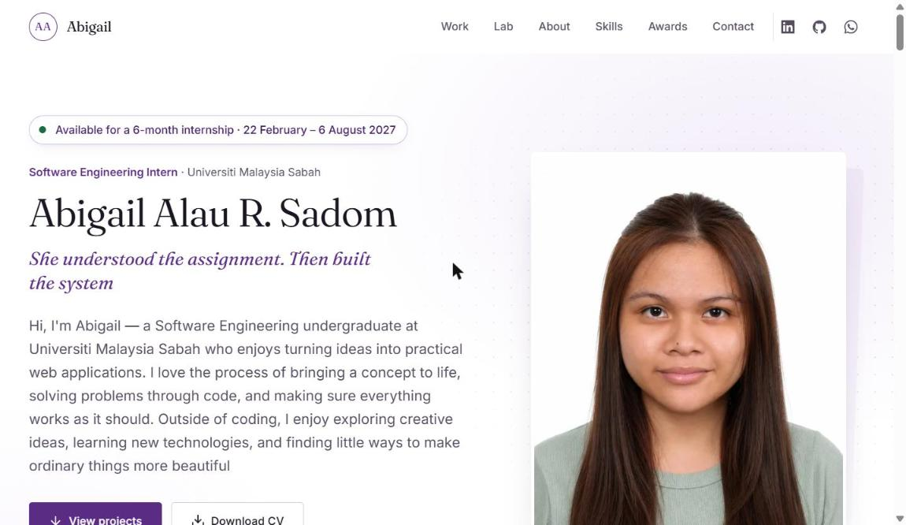

# Abigail Sadom: Portfolio

Personal portfolio built with Vite, React and TypeScript. Static site: no backend.



*Home page of the live portfolio.*

## Project Overview

A personal portfolio for Abigail Alau R. Sadom, a Software Engineering student at Universiti Malaysia Sabah (UMS). It presents her profile, projects, skills, education, experience and awards, together with an interactive **Engineering Lab** that shows how each project is designed and tested: architecture, data model, test scenarios and design decisions.

**Live site:** https://abigailsadom1903.github.io/Abigail-digital-portfolio/

## Problem Statement

A CV or a list of repositories shows what someone built, but not how it works or why it was designed that way. Student projects in particular are hard to evaluate from source code alone, and recruiters rarely have time to clone and run them.

This portfolio puts the work in one place and makes the engineering visible, with architecture views, generated data models, runnable test scenarios and decision notes, while staying easy to update without touching code.

## Features

- **Portfolio sections:** Hero, Work, Engineering Lab, About, Skills, Recognition (awards) and Contact.
- **Engineering Lab:** per-project interactive modules for architecture, data model, testing and a Decision Journal.
- **Testing Playground:** runs test scenarios in the browser against the project's rules, clearly labelled as a simulation.
- **Generated data models** built from each project's database schema (structure only, no data copied).
- **Content management with Pages CMS:** edit profile, projects, skills, education and awards through forms, with upload support for photos, CV, certificates and reports.
- **Content as JSON** in `src/content/`, so the site can also be edited by hand.
- **Accessible design** using design tokens, focus styles and reduced-motion support.
- **Automated deployment** to GitHub Pages on every push to `main`, with optional Netlify hosting.
- **Automated testing:** unit and component tests (Vitest, React Testing Library) and browser tests (Playwright).

## Technology Stack

| Area | Technology |
| --- | --- |
| UI | React, TypeScript |
| Build tool | Vite |
| Content editing | Pages CMS (`.pages.yml`) with JSON content files |
| Unit and component tests | Vitest, React Testing Library |
| End-to-end tests | Playwright |
| Linting | oxlint |
| Hosting | GitHub Pages (GitHub Actions), optional Netlify |

## Architecture

A **static, content-driven single-page site**. All content is bundled at build time; there is no server and no database.

```
JSON content (src/content) ──▶ typed loaders (src/data) ──▶ sections / components ──▶ static build (dist/)
                                                                  ▲
Lab data (architecture, model, testing, decisions) ───────────────┘
```

- **Content layer:** editable JSON files, managed by hand or through Pages CMS forms.
- **Data layer:** typed loaders in `src/data/` turn the JSON into typed objects, keeping content separate from presentation. The Lab loaders also contain schema queries and the test engine.
- **Presentation layer:** page sections (`src/sections/`) assembled from reusable components (`src/components/`), with design tokens in `src/styles/tokens.css`.
- **Data models are generated.** Scripts in `scripts/` read each project's real schema (SQL, a phpMyAdmin export or TypeScript types) and write `model.json`, copying structure only and no data.

## Key Implementation Decisions

- **Static site, no backend.** Cheap to host, with nothing to secure or maintain on a server.
- **Content as JSON plus Pages CMS.** Content can be updated through forms, and every save publishes automatically without editing code.
- **Generated Lab data models.** The portfolio's database diagrams are produced from the real schema files, so they cannot drift from the actual projects.
- **Tests that validate the content.** Each Testing Playground scenario must pass against the real rules (checked by `npm test`), so the interactive demos cannot silently become wrong.
- **A clearly labelled simulation.** The Testing Playground runs in the browser and never connects to the real systems.
- **`BASE_PATH` environment variable** sets the URL path, so the same code builds for GitHub Pages (`/Abigail-digital-portfolio/`) and for Netlify or local development (`/`).
- **Design tokens** in `tokens.css` keep colours, spacing and type consistent across sections.
- **Verified content only.** Blank fields are hidden on the published site, and Church Management System screenshots use sample data only.

## Installation

### Prerequisites

- [Node.js](https://nodejs.org/) (current LTS recommended) and npm
- Git
- Google Chrome (only needed to run the Playwright browser tests)

### Steps

1. **Clone the repository**

   ```bash
   git clone https://github.com/abigailsadom1903/Abigail-digital-portfolio.git
   cd Abigail-digital-portfolio
   ```

2. **Install dependencies**

   ```bash
   npm install
   ```

3. **Start the development server**

   ```bash
   npm run dev
   ```

4. **Open the site** at http://localhost:5173

The full list of commands, deployment options and content-editing instructions follows below.

## Commands

```bash
npm install       # once
npm run dev       # local dev server at http://localhost:5173
npm run build     # type-check (tsc) + production build into dist/
npm run preview   # serve the production build at http://localhost:4173
npm run lint      # oxlint
npm test          # unit + component tests (Vitest, React Testing Library)
npm run test:e2e  # browser tests (Playwright, uses your installed Google Chrome)
```

## Publishing

The site is hosted on GitHub Pages at https://abigailsadom1903.github.io/Abigail-digital-portfolio/
Every push to `main` rebuilds and republishes it automatically (see `.github/workflows/deploy.yml`).

To update the live site after editing:

```bash
git add -A
git commit -m "Describe what you changed"
git push
```

Progress is shown under the repository's **Actions** tab; the site updates about a minute later.

### Netlify (optional)

The site can also be hosted on Netlify, which serves it at the root of its own address.
`netlify.toml` already holds the build settings. In Netlify: **Add new site → Import an existing
project → GitHub → Abigail-digital-portfolio**, keep the detected settings, and deploy. Netlify then
rebuilds on every push to `main`, including Pages CMS saves.

The URL path is set by the `BASE_PATH` environment variable (default `/`). The GitHub Pages
workflow sets it to `/Abigail-digital-portfolio/`; Netlify and local development use `/`.

## Editing content

**Easiest: Pages CMS.** Sign in at https://app.pagescms.org with GitHub, open this repository,
and edit with forms: Profile & About, Projects, Skills, Education, Experience & Awards.
Upload buttons handle the profile photo, CV (PDF), project screenshots and reports (PDF), and a certificate
and photo for each award, training programme or activity. Each save publishes automatically.
The forms are defined in `.pages.yml`.

**By hand:** the same content lives in JSON files in `src/content/`
(`profile.json`, `projects.json`, `skills.json`, `education.json`).
Uploaded files go in `public/images/`, `public/cv/`, `public/certificates/` and `public/reports/`; reference them as `/images/...`, `/cv/...`, `/certificates/...` or `/reports/...`.

Blank fields are hidden on the published site; when running locally (`npm run dev`) they show
as clearly labelled **Placeholders**. Fill in real, verified details only.
**Church Management System screenshots must use sample data only.**

## Engineering Lab

Interactive modules (architecture, data model, testing, decisions) for each project, with data in
`src/content/lab/<project>/`:

| File | What it holds |
| --- | --- |
| `architecture.json` | Components, layers and request flows |
| `model.json` | Generated data model (do not edit by hand) |
| `testing.json` | Test scenarios; each must pass against the real rules (checked by `npm test`) |
| `decisions.json` | Decision Journal entries; fill in `lessons` yourself |

`src/content/lab/portfolio-decisions.json` holds decisions about this site, shown for every project.

Regenerate the data models when the source changes (structure only; no data is copied):

```bash
npm run lab:schema -- ../../church-management-system/database/schema.sql
node scripts/types-to-json.mjs path/to/SchoolFam/types.ts
```

StudyUsia's model (`src/content/lab/studyusia/model.json`) comes from the `CREATE TABLE` statements in its
`DatabaseHelper.kt`. Its foreign keys carry no delete rule because the app's SQLite database does not enable them.
UniFest's model (`src/content/lab/unifest/model.json`) comes from its `unifest_db.sql` phpMyAdmin export.

The Testing Playground runs scenarios in the browser against these rules and is labelled as a
simulation; it never connects to the real systems.

## Structure

```
src/
  styles/         tokens.css (design tokens), global.css (reset, base, focus, motion)
  content/        editable content (JSON, used by Pages CMS)
  content/lab/    Engineering Lab data per project
  data/           loaders that turn content into typed data
  data/lab/       Lab loaders, schema queries and the test engine
  components/     reusable UI: Container, Section, ButtonLink, Placeholder, ProjectList, ImageLightbox, Navbar
  components/lab/ Engineering Lab modules
  sections/       page sections: Hero, Work, Lab, About, Skills, Recognition (awards), Contact, Footer
  hooks/          useActiveSection, useHideOnScroll, useReveal
scripts/          generators for the Lab data models
e2e/              Playwright browser tests
```

## Known Limitations

- **Static content only.** There is no contact-form backend or comments; changes need a rebuild, which happens automatically on every push to `main`.
- **Lab models are snapshots.** They reflect each source schema at the time it was generated and must be regenerated when a project's schema changes.
- **The Testing Playground is a simulation**, not a live connection to the real systems.
- **StudyUsia's Lab model shows no delete rules on foreign keys**, because the app's SQLite database does not enable foreign-key enforcement.
- **End-to-end tests use a locally installed Google Chrome**, so Chrome must be available to run them.
